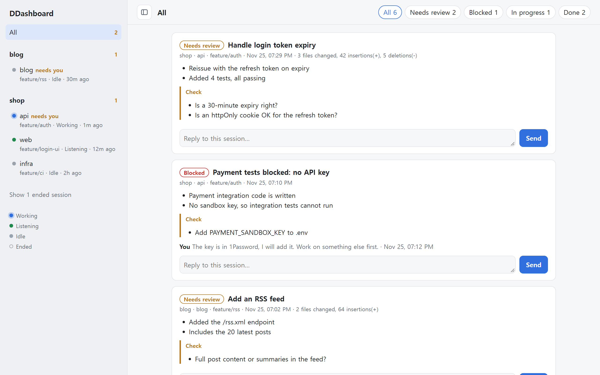

# ddashboard

[English](README.md) | **한국어**

**Claude Code 세션의 작업 결과를 카드 한 장으로 받아 보고, 카드에 단 답글로 그 세션에 바로 지시하는 로컬 대시보드 플러그인입니다.**

   

AI는 사람이 따라가기 어려울 만큼 빠르게 개발하고, 터미널에는 읽기 벅찬 양의 글을 남깁니다. ddashboard는 그중 **사람이 알아야 할 것만** 남깁니다. 카드에는 상태, 핵심 요약 3줄, 확인할 것이 들어갑니다. 사람은 대시보드만 보고, 카드에 답글을 달아 그 세션에 다음 일을 시킵니다.

<picture>
  <source media="(prefers-color-scheme: dark)" srcset="assets/screenshot-dark.png">
  
</picture>

화면 문구는 영어이고, 카드 내용은 사용자가 쓰는 언어로 작성됩니다. 한국어로 대화하면 카드도 한국어로 나옵니다.

## 특징

- **토큰을 거의 쓰지 않습니다.** 카드 기록, 화면 갱신, 답글 대기는 모두 훅과 로컬 스크립트가 처리합니다. 모델이 추가로 쓰는 건 응답 끝의 짧은 카드 블록과, 세션당 한 번 들어가는 약 200토큰의 안내문뿐입니다.
- **답글이 그 세션으로 바로 갑니다.** 쉬고 있는 세션은 답글이 오면 깨어나고, 작업 중인 세션은 지금 턴을 마치는 즉시 답글을 이어서 처리합니다.
- **켠 프로젝트에서만 동작합니다.** 다른 프로젝트의 세션에는 아무 영향이 없습니다(출력 0, 토큰 0). 같은 저장소의 worktree들은 함께 연결되어, 여러 세션의 진행을 한 화면에서 볼 수 있습니다.
- **내 PC 안에서만 돕니다.** 외부 서비스로 아무것도 보내지 않습니다. 서버는 `127.0.0.1`에서만 열리고, 데이터는 `~/.ddashboard`에 저장됩니다.
- **의존성이 없습니다.** Node 18 이상만 있으면 됩니다.

## 설치

Claude Code 안에서 실행합니다.

```
/plugin marketplace add lilohdong/ddashboard
/plugin install ddashboard@ddashboard
```

## 빠른 시작

1. 대시보드로 볼 프로젝트의 Claude Code 세션에서 입력합니다.
   ```
   /ddashboard:dashboard
   ```
2. 브라우저에서 http://127.0.0.1:7357 을 엽니다.
3. 세션이 답글 대기 명령(`wait-inbox.js`)을 실행하려고 권한을 물으면 **항상 허용**을 선택합니다. 이 명령은 답글이 올 때까지 조용히 기다리기만 합니다.
4. 평소처럼 일을 시킵니다. 보고할 결과가 생기면 카드가 올라옵니다.
5. 카드에 답글을 달면(Ctrl+Enter) 그 세션이 받아서 처리합니다.

끌 때는 `/ddashboard:dashboard off`를 입력합니다. 연결된 프로젝트가 하나도 남지 않으면 서버도 꺼집니다.

## 대시보드 화면

- **사이드바:** 연결된 세션을 프로젝트별로 묶어 보여 줍니다. 프로젝트나 세션을 누르면 그 카드만 봅니다. 왼쪽 위 버튼이나 `[` 키로 접고 펼칩니다.
  | 표시 | 뜻 |
  |---|---|
  | 파란 점 (`Working`) | 작업 중 |
  | 초록 점 (`Listening`) | 답글 대기. 답글을 보내면 바로 전달됨 |
  | 회색 점 (`Idle`) | 쉬는 중. 답글은 다음 턴이 끝날 때 전달됨 |
  | 빈 점 (`Ended`) | 종료 (기본으로 숨김) |
  | `needs you` | 마지막 카드가 `Needs review`(검토 필요) 또는 `Blocked`(막힘)이고 아직 답글을 달지 않은 세션 |
- **토큰 미터:** 세션 줄마다 마지막 턴의 맥락 크기(예: `ctx 120k`)와 연결된 뒤 쓴 누적 토큰을 보여 줍니다. 맥락이 `DDASH_CONTEXT_WARN`(기본 15만)을 넘으면 빨간색이 됩니다. 세션 목록 아래 `Today`에는 오늘 모든 세션의 입력, 캐시 읽기, 출력 토큰 합계가 나옵니다. 마우스를 올리면 캐시 쓰기와 턴 수까지 정확한 값이 보입니다. 값은 Stop 훅이 세션 transcript에서 읽으며, 모델을 호출하지 않습니다.
- **검색:** 위쪽 검색창(`/` 키로 이동, `Esc`로 지우기)에서 보관된 카드까지 모든 카드를 찾습니다.
- **필터:** 상태별로 카드를 거르고, 상태마다 개수를 보여 줍니다.
- **보관:** 카드마다 Archive 버튼이 있습니다. 14일 지난 카드와 새 버전으로 교체된 카드는 자동으로 보관됩니다. 사이드바 아래 `Archived (N)`을 누르면 보관함이 열리고, 거기서 다시 꺼낼 수 있습니다.
- **카드:** 프로젝트, 세션, 브랜치, 시각, 변경 통계와 함께 요약, 확인할 것(`Check`), 긴 내용을 접어 두는 `Details`를 보여 줍니다. 종료된 세션의 카드에는 답글 창이 나오지 않습니다.

## 여러 세션, 여러 프로젝트와 함께 쓰기

대시보드를 켠 뒤 같은 저장소에서 여는 세션은 다른 worktree에서 연 것까지 자동으로 연결됩니다. 기능별 worktree마다 `claude`를 하나씩 띄워 두면, 모든 세션의 결과가 한 화면에 모이고 카드마다 그 세션에 따로 지시할 수 있습니다.

여러 프로젝트에서 각각 대시보드를 켜면, 모두 같은 대시보드에 모이고 사이드바에서 프로젝트별로 나뉩니다. 프로젝트를 늘려도 세션당 토큰 비용은 같습니다.

프로젝트마다 대시보드를 따로 띄우고 싶다면, 각 프로젝트의 `.claude/settings.json`에 서로 다른 포트와 저장 위치를 지정합니다.

```json
{ "env": { "DDASH_PORT": "7358", "DDASH_BOARD_DIR": "~/.ddashboard-blog" } }
```

대시보드에 보일 세션 이름은 기본으로 폴더 이름이고, `DDASH_NAME` 환경 변수로 바꿀 수 있습니다.

## 동작 방식

```
 세션이 한 턴을 끝냄 ── 응답 끝에 card 블록
          │
          ▼  Stop 훅 (모델 호출 없음)
 ~/.ddashboard/cards/YYYY-MM.jsonl ── 브랜치, diff 통계 자동 첨부
          │
          ▼
 로컬 서버 + 대시보드 (127.0.0.1:7357)
          │  카드에 답글
          ▼
 ~/.ddashboard/inbox/<세션 ID>/
          │
          ├─ 세션이 쉬는 중 → 백그라운드 대기 명령이 끝나면서 세션을 깨움
          └─ 세션이 작업 중 → 턴이 끝날 때 Stop 훅이 답글을 다음 지시로 넘김
```

| 훅 | 하는 일 |
|---|---|
| `SessionStart` | 연결된 프로젝트의 새 세션을 등록하고 카드 규칙을 알려 줌 |
| `UserPromptSubmit` | 대시보드 켜기/끄기, 먼저 열려 있던 세션 연결, "작업 중" 표시 |
| `Stop` | 카드와 턴 토큰 사용량(`usage/YYYY-MM.jsonl`) 기록, 대기 중인 답글 전달, "쉬는 중" 표시 |
| `SessionEnd` | "종료" 표시 |

모든 훅은 모델을 호출하지 않습니다. 연결되지 않은 세션에서는 아무것도 출력하지 않습니다.

## 설정

| 환경 변수 | 기본값 | 설명 |
|---|---|---|
| `DDASH_PORT` | `7357` | 대시보드 포트 |
| `DDASH_BOARD_DIR` | `~/.ddashboard` | 카드, 답글, 세션 정보 저장 위치 |
| `DDASH_NAME` | 폴더 이름 | 대시보드에 표시할 세션 이름 |
| `DDASH_POLL_MS` | `1500` | 대기 명령이 답글을 확인하는 주기(ms) |
| `DDASH_RECENT_DAYS` | `14` | 이 기간이 지난 카드는 자동으로 보관 |
| `DDASH_CONTEXT_WARN` | `150000` | 세션의 `ctx`가 이 토큰 수를 넘으면 경고 색. 서버가 읽음 |

서버만 따로 다룰 때:

```
node <플러그인 경로>/scripts/control.js start | stop | status
```

## 자주 묻는 질문

**토큰이 정말 안 드나요?**
대시보드 자체는 모델을 호출하지 않습니다. 추가되는 건 세션당 약 200토큰의 안내문과, 보고할 결과가 있는 턴의 카드 블록(보통 100~200토큰)입니다. 답글을 처리하는 비용은 터미널에 직접 입력했을 때와 같습니다.

**세션을 닫은 뒤에 답글을 달면요?**
이 버전에서는 닫힌 세션에 답글이 전달되지 않고 인박스(`~/.ddashboard/inbox/<세션 ID>/`)에 남기만 합니다. 바로 전달하려면 초록 점(`Listening`)인 세션에 답글을 다세요. 자동 처리는 로드맵에 있습니다.

**포트가 이미 쓰이고 있다고 나와요.**
`DDASH_PORT`로 다른 포트를 지정하세요.

**데이터를 지우고 싶어요.**
`~/.ddashboard` 폴더를 지우면 됩니다.

## 로드맵

- [ ] 닫힌 세션에 온 답글을 `claude -p --resume`으로 자동 처리
- [ ] 팀장 세션이 작업을 나눠 worktree에 서브 세션을 띄우는 모드
- [x] 카드 보관(아카이브)과 검색 (0.2.0)

## 기여

이슈와 PR을 환영합니다. 브랜치는 Git Flow를 따릅니다. `develop`에서 `feature/*` 브랜치를 만들고, PR은 `develop`으로 보내 주세요.

## 라이선스

[MIT](LICENSE)
