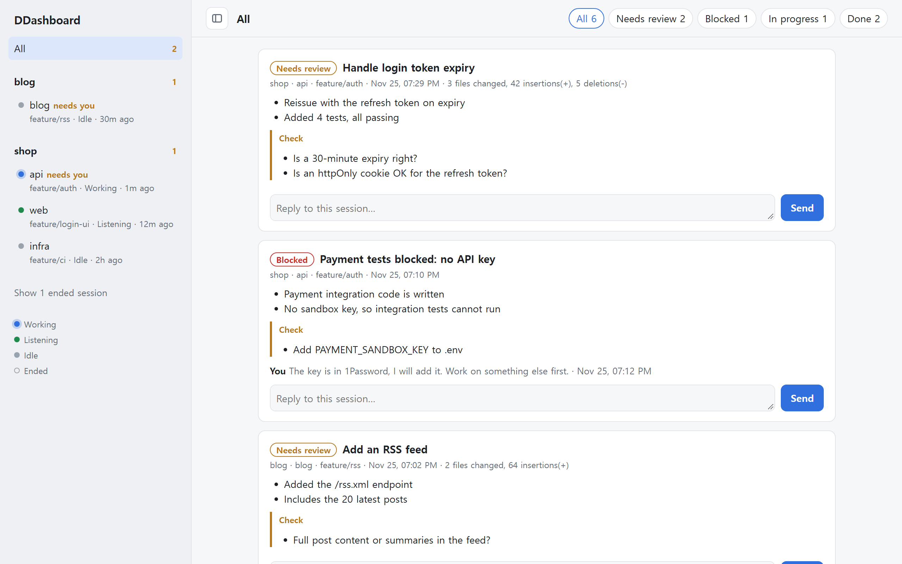

# ddashboard

**English** | [한국어](README.ko.md)

**A local dashboard for Claude Code: see each session's results as a short card, and reply on the card to instruct that session.**

   

AI writes code faster than people can follow, and leaves more text in the terminal than anyone wants to read. ddashboard keeps only **what you need to know**: a status, a three-line summary, and what you should check. You watch the dashboard, and reply on a card to tell that session what to do next.

<picture>
  <source media="(prefers-color-scheme: dark)" srcset="assets/screenshot-dark.png">
  
</picture>

## Features

- **Almost no extra tokens.** Hooks and local scripts record cards, refresh the page, and wait for replies. The model only adds a short card block at the end of a reply, plus about 200 tokens of instructions once per session.
- **Replies go straight to the right session.** An idle session wakes up when a reply arrives; a busy one picks it up as soon as it finishes its current turn.
- **Only where you turn it on.** Sessions in other projects are untouched (no output, no tokens). Worktrees of the same repository are connected together, so you can follow several sessions on one screen.
- **Everything stays on your machine.** Nothing is sent to an external service. The server listens on `127.0.0.1` only, and data lives in `~/.ddashboard`.
- **No dependencies.** Node 18 or later is all you need.

## Install

Run inside Claude Code:

```
/plugin marketplace add lilohdong/ddashboard
/plugin install ddashboard@ddashboard
```

## Quick start

1. In a Claude Code session in the project you want to follow, type:
   ```
   /ddashboard:dashboard
   ```
2. Open http://127.0.0.1:7357 in your browser.
3. When the session asks for permission to run the wait command (`wait-inbox.js`), choose **always allow**. It only waits quietly for your replies.
4. Work as usual. A card shows up whenever there's a result worth reporting.
5. Reply on a card (Ctrl+Enter) and that session handles it.

To turn it off, type `/ddashboard:dashboard off`. The server stops once no project is connected.

## The dashboard

- **Sidebar:** connected sessions, grouped by project. Click a project or a session to see only its cards. Collapse it with the button at the top left or the `[` key.
  | Mark | Meaning |
  |---|---|
  | Blue dot | Working |
  | Green dot | Listening — a reply is delivered immediately |
  | Gray dot | Idle — a reply is delivered when the next turn ends |
  | Hollow dot | Ended (hidden by default) |
  | `needs you` | The session's latest card is "Needs review" or "Blocked" |
- **Filters:** narrow cards by status, with a count for each.
- **Cards:** project, session, branch, time, and diff stats, plus the summary and what to check. Cards from ended sessions don't show a reply box.

## Multiple sessions and projects

Once the dashboard is on, any session you open in the same repository connects automatically, including sessions in other worktrees. Run one `claude` per feature worktree, and every session's results land on one screen, where you can instruct each session separately.

Turn the dashboard on in several projects and they all share one dashboard, split by project in the sidebar. Adding projects doesn't change the token cost per session.

To give a project its own dashboard instead, set a different port and data directory in that project's `.claude/settings.json`:

```json
{ "env": { "DDASH_PORT": "7358", "DDASH_BOARD_DIR": "~/.ddashboard-blog" } }
```

A session's name defaults to its folder name; override it with the `DDASH_NAME` environment variable.

## How it works

```
 A session ends its turn ── card block at the end of the reply
          │
          ▼  Stop hook (no model calls)
 ~/.ddashboard/cards.jsonl ── branch and diff stats attached automatically
          │
          ▼
 Local server + dashboard (127.0.0.1:7357)
          │  you reply on a card
          ▼
 ~/.ddashboard/inbox/<session id>/
          │
          ├─ session idle → the background wait command exits and wakes the session
          └─ session busy → when the turn ends, the Stop hook hands the reply over as the next instruction
```

| Hook | What it does |
|---|---|
| `SessionStart` | Registers new sessions in connected projects and gives them the card rules |
| `UserPromptSubmit` | Turns the dashboard on/off, connects sessions that started earlier, marks the session "Working" |
| `Stop` | Records cards, delivers waiting replies, marks the session "Idle" |
| `SessionEnd` | Marks the session "Ended" |

No hook calls the model, and none of them print anything in sessions that aren't connected.

## Configuration

| Environment variable | Default | Description |
|---|---|---|
| `DDASH_PORT` | `7357` | Dashboard port |
| `DDASH_BOARD_DIR` | `~/.ddashboard` | Where cards, replies, and session info are stored |
| `DDASH_NAME` | folder name | Session name shown on the dashboard |
| `DDASH_POLL_MS` | `1500` | How often the wait command checks for replies (ms) |

To manage the server directly:

```
node <plugin path>/scripts/control.js start | stop | status
```

## FAQ

**Does it really cost no tokens?**
The dashboard itself never calls the model. What's added is about 200 tokens of instructions per session and the card block on turns that report a result (usually 100–200 tokens). Handling a reply costs the same as typing it into the terminal.

**What if I reply after closing a session?**
In this version, replies to a closed session are not delivered; they stay in the inbox (`~/.ddashboard/inbox/<session id>/`). Reply to sessions with a green dot (listening) for instant delivery. Automatic handling is on the roadmap.

**It says the port is already in use.**
Pick another port with `DDASH_PORT`.

**How do I delete my data?**
Delete the `~/.ddashboard` folder.

## Roadmap

- [ ] Handle replies to closed sessions automatically with `claude -p --resume`
- [ ] A lead session that splits work and launches sub-sessions in worktrees
- [ ] Archive and search cards

## Contributing

Issues and pull requests are welcome. Branches follow Git Flow: branch `feature/*` off `develop`, and open pull requests against `develop`.

## License

[MIT](LICENSE)
